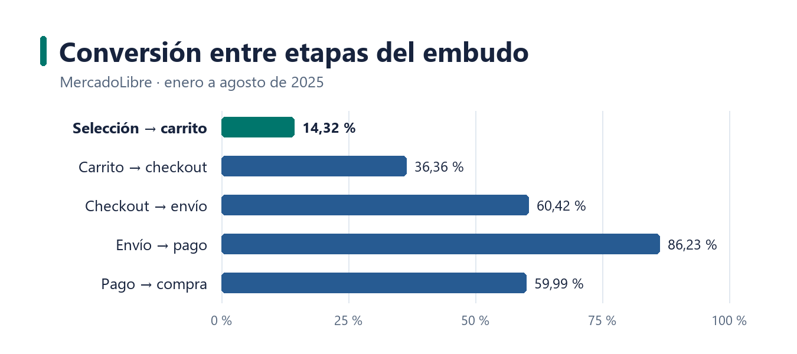
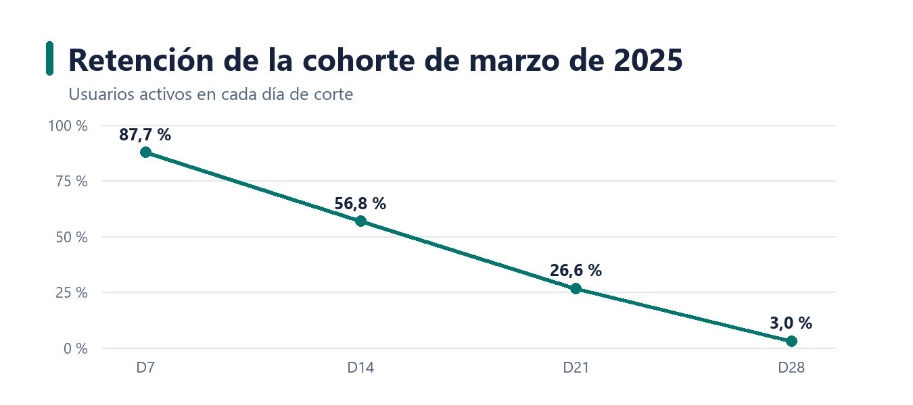

# MercadoLibre Funnel & Retention Analysis

## Project Overview

Proyecto de portafolio de Miguel Torres sobre conversión y retención en un marketplace. El análisis combina SQL y Excel para localizar las mayores caídas en el recorrido de compra y medir el regreso de usuarios durante los primeros 28 días después del registro.

## Business Context

El equipo de producto necesita decidir dónde intervenir para que más usuarios avancen hacia la compra y en qué momento probar una acción de reactivación. El embudo localiza las transiciones con mayor pérdida. Las cohortes muestran cuándo disminuye la actividad después del registro.

## Datasets Used

### 1. `mercadolibre_funnel`

Registra eventos de compra con identificadores de usuario y sesión, fecha del evento, país, dispositivo y fuente de tráfico. El encargo define el periodo del 1 de enero al 31 de agosto de 2025 para el análisis del embudo.

### 2. `mercadolibre_retention`

Registra actividad después del alta. El campo `signup_date` define la cohorte y los campos `day_after_signup` y `active` permiten medir D7, D14, D21 y D28. El encargo solicita evaluar registros del 1 de enero al 1 de junio de 2025. La tabla del Excel también incluye cohortes posteriores.

## Project Objectives

Construir un embudo multietapa, calcular la conversión entre pasos e identificar la mayor caída. Medir la actividad después del registro, comparar resultados por país y proponer acciones con métricas que el equipo de producto pueda evaluar.

## Analytical Workflow

### 1. Data Loading and Initial Exploration

Las consultas de exploración revisan las primeras filas de ambas tablas y enumeran los tipos de evento. El esquema permite identificar los campos que conectan el recorrido de compra con las métricas de conversión y los campos que permiten medir la actividad posterior al registro.

### 2. Data Quality Review

La revisión para reproducir los resultados debe comprobar identificadores faltantes, eventos repetidos y la cobertura de observación de cada cohorte. Las comparaciones por país requieren los conteos de usuarios que respaldan cada tasa.

### 3. Data Cleaning

La preparación debe fijar los filtros de fechas y las reglas para ordenar y deduplicar eventos. También debe documentar si `select_promotion` se agrupa con `select_item`, porque esa decisión afecta el denominador de la transición hacia el carrito.

### 4. User-Level Aggregation

El recorrido conceptual pasa por primera visita, selección, carrito, inicio de checkout, envío, pago y compra. Para cada transición, el denominador corresponde a quienes alcanzaron el paso anterior. La retención usa como unidad al usuario registrado y requiere documentar quién tuvo seguimiento suficiente para cada día de corte.

### 5. Descriptive Analysis

El Excel distingue el avance acumulado del avance entre etapas. La hoja `Embudo General` muestra 76,90 % acumulado en selección y 11,01 % acumulado en carrito. Su cociente es 14,32 %, la proporción que pasó de selección a carrito.

### 6. Data Visualization

La primera gráfica compara las tasas de conversión entre etapas consecutivas. La barra destacada identifica el paso con menor conversión entre los reportados.

<p align="center">
  
</p>

*Fuente del gráfico. Excel aprobado «Proyecto 4 · Análisis de embudo y retención para MercadoLibre · Resumen ejecutivo (3)», hoja `Resumen`, rango `A9:C14`.*

La segunda gráfica muestra una cohorte del periodo solicitado. Cada punto corresponde a un día de corte posterior al registro.

<p align="center">
  
</p>

*Fuente del gráfico. Excel aprobado «Proyecto 4 · Análisis de embudo y retención para MercadoLibre · Resumen ejecutivo (3)», hoja `Retencion x Cohort`, encabezados `A1:E1` y cohorte de marzo `A4:E4`.*

### 7. Outlier Detection

La cohorte de agosto registra 70,8 % en D7 y 0,2 % en D28 en la tabla de cohortes. Como queda fuera del corte principal solicitado, se revisa por separado. La cobertura hasta D28 y el tamaño de la cohorte ayudarán a interpretar el resultado.

### 8. Customer Segmentation

La tabla por país muestra diferencias en D28. Por ejemplo, Perú registra 3,2 %, México 3,1 % y Colombia 1,6 %. Antes de priorizar un mercado, se necesitan los tamaños de muestra y criterios de observación comparables.

### 9. Executive Insights

El embudo sitúa la primera prueba de conversión en la ficha de producto. La caída de actividad después de D7 sitúa la prueba de retención en las semanas iniciales. Cada intervención tiene una métrica distinta y puede evaluarse por separado.

## Key Tasks Performed

La entrega original incluye exploración de ambas tablas, resultados del embudo general y por país, retención por cohorte y por país y un informe ejecutivo. Las dos gráficas de esta versión se generaron a partir del Excel aprobado.

## Key Findings

- **Conversión.** Entre enero y agosto de 2025, el paso de selección a carrito registró la mayor fuga entre las transiciones reportadas. Avanzó el **14,32 %** y se perdió el **85,68 %**. Esto sitúa la primera prueba antes del checkout, en la información que el usuario ve al seleccionar un producto.
- **Retención.** Para el corte de registros indicado en el informe ejecutivo, la actividad reportada bajó de **86,6 % en D7** a **55,4 % en D14** y **2,6 % en D28**. La caída de **31,2 puntos porcentuales** entre D7 y D14 identifica una ventana para probar la reactivación y medir si se sostiene hasta D28.

## Business Recommendations

Probar si mostrar el costo y el plazo estimado de entrega en la ficha aumenta el paso a carrito. Medir también la compra final para comprobar si el efecto llega al final del embudo. Para retención, probar un mensaje entre D7 y D14 y comparar la actividad posterior con la de un grupo de control.

## Tools and Skills

SQL se usa para explorar los datos y estructurar el embudo y la retención por cohortes. Excel contiene las tablas de resultados y el informe ejecutivo. El caso reúne definición de métricas, comparación de segmentos e interpretación de resultados para un equipo de producto.

## Professional Value

El proyecto muestra cómo convertir preguntas de crecimiento en decisiones evaluables. El embudo ayuda a priorizar una transición concreta. Las cohortes ayudan a elegir cuándo intervenir y en qué día medir si los usuarios regresan.

## Personal Voice & Learning

Aprendí que seleccionar un producto y agregarlo al carrito son señales distintas de intención de compra. Medir ese paso me permitió pasar de una pregunta general sobre abandono a una prueba concreta en la ficha del producto. En retención, aprendí a revisar qué usuarios entran en el denominador y cuánto tiempo se observó a cada cohorte antes de comparar tasas.

## Repository Structure

```text
mercadolibre-funnel-retention-analysis/
├── images/
│   ├── 1_mercadolibre-funnel-conversion.png
│   └── 2_mercadolibre-march-2025-cohort-retention.png
├── README.md
└── mercadolibre-funnel-retention-analysis.xlsx
```

### File Guide

`README.md` presenta el contexto, el método y los hallazgos. `images/` contiene los dos PNG que se muestran en el README. `mercadolibre-funnel-retention-analysis.xlsx` es el libro de trabajo publicado en el repositorio. Las fuentes exactas de las dos gráficas se indican bajo cada imagen.

## Reproducibility Note

Las gráficas se pueden reconstruir con los rangos citados del Excel aprobado. Reproducir las tasas desde los datos requiere las tablas fuente, las consultas SQL completas y los conteos por etapa y cohorte. Queda pendiente conciliar dos diferencias entre las tasas que publica `Resumen` y las que se obtienen al dividir las cifras acumuladas de `Embudo General`. Envío a pago figura como 86,23 % frente a 86,21 % recalculado, y pago a compra como 59,99 % frente a 60,00 %. El 14,32 % de selección a carrito coincide por ambas vías.
